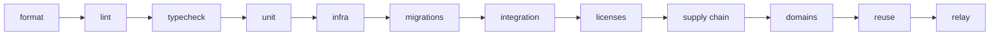
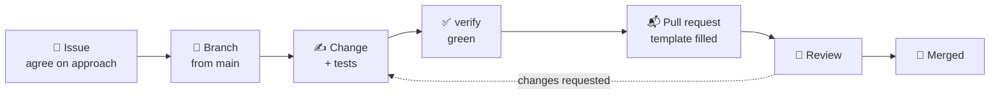

<!--
SPDX-FileCopyrightText: 2026 CommonAir contributors
SPDX-License-Identifier: CC-BY-SA-4.0
-->

<div align="center">

<picture>
  <source media="(prefers-color-scheme: dark)" srcset="docs/assets/brand/contributing-banner-dark.svg">
  <source media="(prefers-color-scheme: light)" srcset="docs/assets/brand/contributing-banner-light.svg">
  
</picture>

<br>
<br>

[](https://github.com/abolishus/commonair/labels/good%20first%20issue)
[](#developer-certificate-of-origin-dco)
[](#commit-messages)
[](CODE_OF_CONDUCT.md)

**[Set up](#getting-set-up)** · **[Make a change](#pull-request-flow)** · **[Rules](#the-rules-every-change-follows)** · **[Find work](#finding-something-to-work-on)** · **[Get help](#questions)**

</div>

---

Thank you for helping build CommonAir, a member-owned cooperative live streaming platform. This
guide covers how to set up, how a change gets merged, and the rules every contribution follows.
You do not need to be a co-op member to contribute.

> [!IMPORTANT]
> By taking part you agree to the [Code of Conduct](CODE_OF_CONDUCT.md). Security problems go
> through [SECURITY.md](SECURITY.md), **never a public issue**.

## Ways to help

| How                       | Where to start                                                                                                                                                                 |
| ------------------------- | ------------------------------------------------------------------------------------------------------------------------------------------------------------------------------ |
| 🐛 **Report a bug**       | Use the [bug report form](https://github.com/abolishus/commonair/issues/new/choose) with steps to reproduce                                                                    |
| 💡 **Propose a feature**  | Open a [feature request](https://github.com/abolishus/commonair/issues/new/choose); check the [roadmap](ROADMAP.md) and its non-goals first                                    |
| 🧑‍💻 **Write code**         | Pick up a [good first issue](https://github.com/abolishus/commonair/labels/good%20first%20issue) or [help wanted](https://github.com/abolishus/commonair/labels/help%20wanted) |
| 📝 **Improve docs**       | Self-hosting guides, runbooks and ADRs in [`docs/`](docs/) are all fair game                                                                                                   |
| ♿ **Test accessibility** | Keyboard, screen reader and contrast findings get the `accessibility` label                                                                                                    |
| 👀 **Review**             | Thoughtful review on open pull requests is as valuable as code                                                                                                                 |

## Getting set up

You need:

| Tool                                              | Version | For                       |
| ------------------------------------------------- | ------- | ------------------------- |
| [Bun](https://bun.sh)                             | 1.4.3   | Everything TypeScript     |
| [Podman](https://podman.io) with `podman-compose` | 5+      | Data services, full stack |
| [Go](https://go.dev)                              | 1.27    | The member relay          |
| [FFmpeg](https://ffmpeg.org)                      | any     | Harness streamers         |
| [`reuse`](https://reuse.software)                 | any     | License header check      |

The [README](README.md#developing) covers installing Podman on Linux and macOS.

```sh
git clone https://github.com/abolishus/commonair.git
cd commonair
bun install
bun scripts/init-env.ts          # a local .env with fresh secrets; never committed
bun scripts/infra.ts test        # Postgres, Valkey, Mailpit, Garage; waits for health
bun run verify --quick           # fast checks: your inner loop
```

### The gate

`bun run verify` is the single gate. It must be green before a change merges.



| Command                             | When                                                                                                           |
| ----------------------------------- | -------------------------------------------------------------------------------------------------------------- |
| `bun run verify --quick`            | While you work. Skips integration tests, so never the final word                                               |
| `bun run verify`                    | Before you open or update a PR                                                                                 |
| `bun run verify:full`               | Adds the full harness scenario. Use it when you touch ingest, delivery, chat or anything performance-sensitive |
| `bun run verify --only static,unit` | One group at a time, the way CI splits the jobs                                                                |
| `bun scripts/coverage.ts`           | Unit-test line coverage per workspace, the number behind the README badge                                      |

Formatting, linting and tests run on Vite+: `vp fmt`, `vp lint --deny-warnings`, `vp test`.

## Pull request flow



1. **Talk first** for anything larger than a small fix: open or comment on an issue so we agree
   on the approach before you spend the time.
2. **Fork and branch** from `main`.
3. **Keep it focused.** One change per PR; split unrelated work. Small PRs get reviewed sooner.
4. **Test it.** Run `bun run verify`.
5. **Open the PR** with the template and fill in its checklist.
6. **Review.** CI must be green. A maintainer reviews, asks questions and may request changes.
   Once approved, a maintainer squash-merges it.

[GOVERNANCE.md](GOVERNANCE.md) explains how review and technical decisions work, and how they
relate to the co-op's member votes.

### Developer Certificate of Origin (DCO)

Every commit is signed off under the
[Developer Certificate of Origin 1.1](https://developercertificate.org/). The sign-off certifies
that you wrote the change, or otherwise have the right to submit it under the project's
licenses. Add it with `-s`:

```sh
git commit -s -m "fix(chat): drop messages from banned users"
```

That appends a trailer with your Git name and email:

```
Signed-off-by: Your Name <you@example.org>
```

> [!TIP]
> **Why a DCO and not a CLA?** A contributor license agreement usually lets one party relicense
> everyone's work. We do not want anyone, the cooperative included, to hold that power. Under
> the DCO each contributor keeps their copyright and licenses their work under
> AGPL-3.0-or-later. Because the copyright is spread across everyone who contributed, the code
> can never be relocked as proprietary software.

<details>
<summary><b>Forgot to sign off?</b></summary>

<br>

Commits without a sign-off cannot be merged. Fix them and force-push:

```sh
git commit --amend --no-edit -s      # the last commit only
git rebase --signoff main            # every commit on your branch
git push --force-with-lease
```

</details>

### Commit messages

Commits follow [Conventional Commits](https://www.conventionalcommits.org/):
`type(scope): summary`. The PR title follows the same format, because it becomes the squash
commit message.

| Type                     | For                                   | Example                                      |
| ------------------------ | ------------------------------------- | -------------------------------------------- |
| `feat`                   | New behavior                          | `feat(irc): support CAP LS 302`              |
| `fix`                    | A bug fix                             | `fix(chat): drop messages from banned users` |
| `docs`                   | Documentation only                    | `docs(self-hosting): document relay ports`   |
| `test`                   | Tests only                            | `test(ledger): cover zero-amount refunds`    |
| `refactor`               | Restructuring with no behavior change | `refactor(api): split playback handlers`     |
| `perf`                   | Faster or lighter                     | `perf(origin): cache rewritten playlists`    |
| `build` · `ci` · `chore` | Tooling, pipelines, housekeeping      | `ci: pin setup-go to a commit SHA`           |

Mark a breaking change with `!` after the type (`feat(api)!: …`) or a `BREAKING CHANGE:` footer.

## The rules every change follows

[AGENTS.md](AGENTS.md) holds the full engineering rules, for human and machine-written changes
alike: code style, module boundaries, error handling and testing conventions. Read it before
your first PR. The ones people trip over most:

<table>
  <tr>
    <td width="50%" valign="top">
      <h4>🧪 Tests are mandatory</h4>
      Every behavior change ships with tests. A bug fix includes a test that fails without the
      fix. Service changes need integration coverage with a real Postgres or Valkey, not mocks;
      streaming paths get a harness scenario.
    </td>
    <td width="50%" valign="top">
      <h4>🔒 Strict TypeScript</h4>
      Strict mode everywhere, no <code>any</code>, and validation with the shared Zod schemas at
      every boundary. Do not weaken the compiler settings to make a change build.
    </td>
  </tr>
  <tr>
    <td width="50%" valign="top">
      <h4>🏷️ License headers</h4>
      Every file carries an SPDX header: AGPL-3.0-or-later for code, CC-BY-SA-4.0 for docs,
      CC0-1.0 for small config. Files that cannot hold a comment are covered in
      <code>REUSE.toml</code>. <code>reuse lint</code> runs in the gate.
    </td>
    <td width="50%" valign="top">
      <h4>🔑 Never commit secrets</h4>
      Only <code>.env.example</code>, with placeholder values, belongs in git. If a secret slips
      in, tell a maintainer at once so it can be rotated; rewriting history is not enough.
    </td>
  </tr>
  <tr>
    <td width="50%" valign="top">
      <h4>🌐 Names and domains live in one place</h4>
      The project name, domain and contact addresses come from <code>SITE</code> in
      <code>@commonair/config/site</code>. The stray-domain check fails on hard-coded copies
      outside Markdown.
    </td>
    <td width="50%" valign="top">
      <h4>🎨 Web UI conventions</h4>
      shadcn/ui on Base UI, Hugeicons, Rubik, colors as CSS tokens only, dark mode first,
      WCAG AA, every string through <code>t("key")</code>. Browse the
      <a href="https://abolishus.github.io/commonair/">Storybook</a> for the house components.
    </td>
  </tr>
</table>

### Adding a dependency

Prefer the standard library and what the repository already uses. If you need something new:

- **Vet it first** with `bun scripts/vet-package.ts <name>[@version]`. It refuses versions
  published less than 7 days ago, versions with known vulnerabilities, deprecated versions and
  non-OSI licenses, and flags install scripts, missing provenance and publisher changes for you
  to review. Install the exact version it prints. Upgrades follow the same rule
  ([ADR 0022](docs/decisions/0022-supply-chain.md)).
- **OSI licenses only.** MIT, Apache-2.0, the BSD family, ISC, MPL-2.0, LGPL, GPL, AGPL, and OFL
  for fonts. The license check fails on anything else, including source-available licenses
  (BUSL, SSPL, Elastic, RSAL, Commons Clause).
- **Proprietary services are optional adapters.** Payment processors, CDNs, OAuth providers and
  commercial object storage may be added only as adapters; the platform must run fully without
  them.
- **Nothing third-party in the browser.** No analytics, trackers, font CDNs or remote scripts.
- **Record judgment calls.** An unusual license, a large transitive tree or a rejected
  alternative gets an ADR in [`docs/decisions/`](docs/decisions/).

## Finding something to work on

- [**good first issue**](https://github.com/abolishus/commonair/labels/good%20first%20issue):
  scoped, mentored tasks. A maintainer has described the approach and will help you through it.
- [**help wanted**](https://github.com/abolishus/commonair/labels/help%20wanted): open for
  anyone to pick up.
- [**accessibility**](https://github.com/abolishus/commonair/labels/accessibility): barriers
  that keep someone from using the platform.

Comment on an issue to claim it, so nobody duplicates the work.

## Where decisions are recorded

Significant technical decisions are Architecture Decision Records in
[`docs/decisions/`](docs/decisions/). Read the ones for the area you are changing before you
propose something different, and include a new ADR when your PR makes a significant decision.
[ROADMAP.md](ROADMAP.md) lists what is planned and what is out of scope;
[docs/architecture.md](docs/architecture.md) is the map of how the pieces fit.

## Questions

Ask on the issue you are working on, or write to hello@commonair.tv. We are glad you are here.

<div align="center">
<br>
<sub>Built in the open by its members. One member, one vote.</sub>
</div>
