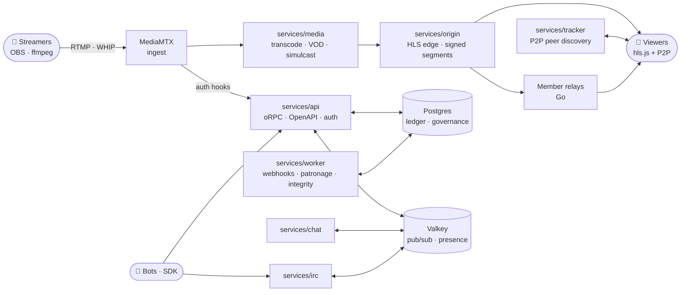

<!--
SPDX-FileCopyrightText: 2026 CommonAir contributors
SPDX-License-Identifier: CC-BY-SA-4.0
-->

<div align="center">

<a href="https://github.com/abolishus/commonair">
  <picture>
    <source media="(prefers-color-scheme: dark)" srcset="docs/assets/brand/readme-banner-dark.svg">
    <source media="(prefers-color-scheme: light)" srcset="docs/assets/brand/readme-banner-light.svg">
    
  </picture>
</a>

<br>
<br>

<!-- The Scorecard badge reads the API with a query string: the bare URL (which shields.io's
     ossf-scorecard badge uses) is stuck on a CDN-cached 404 although results publish fine. -->

[](https://github.com/abolishus/commonair/actions/workflows/ci.yml)
[](https://github.com/abolishus/commonair/actions/workflows/vulnerabilities.yml)
[](https://github.com/abolishus/commonair/actions/workflows/storybook-pages.yml)
[](https://scorecard.dev/viewer/?uri=github.com/abolishus/commonair)
[](https://github.com/abolishus/commonair/releases)
[](LICENSE)
[](https://reuse.software)
[](docs/self-hosting/verifying.md)
<br>
[](https://bun.sh)
[](https://www.typescriptlang.org)
[](relay/)
[](https://podman.io)
[](https://www.conventionalcommits.org)
[](CONTRIBUTING.md#developer-certificate-of-origin-dco)
[](https://github.com/abolishus/commonair/labels/good%20first%20issue)

**[Self-host](docs/self-hosting/)** · **[Contribute](CONTRIBUTING.md)** · **[Architecture](docs/architecture.md)** · **[Roadmap](ROADMAP.md)** · **[Component library](https://abolishus.github.io/commonair/)** · **[Governance](GOVERNANCE.md)**

</div>

---

**CommonAir is a member-owned cooperative streaming platform.** Streamers, viewers and workers
are members. The platform takes a small cut, and the surplus goes back to members as patronage.
One member, one vote.

It is free software. Anyone can read, run, self-host and fork it, and every running instance
links to the exact source it runs.

> [!NOTE]
> CommonAir is **pre-1.0 and under active construction**. Release candidates are out for
> self-hosters to try; expect rough edges. [ROADMAP.md](ROADMAP.md) says what is planned,
> [PROGRESS.md](PROGRESS.md) what is done.

## Why CommonAir

<table>
  <tr>
    <td width="33%" valign="top">
      <h3>🗳️ Owned by members</h3>
      Membership classes for streamers, viewers and workers, elected councils, binding votes and
      patronage payouts. The rules that protect members are enforced by the database, not by
      good intentions.
    </td>
    <td width="33%" valign="top">
      <h3>📖 Free, all the way down</h3>
      AGPL-3.0-or-later, OSI-licensed dependencies only, no trackers, no font CDNs, no remote
      scripts. Stripe, OAuth providers and CDNs are optional adapters with free defaults.
    </td>
    <td width="33%" valign="top">
      <h3>📡 Delivered by its members</h3>
      Members can run a relay: a single static Go binary that serves segments to nearby viewers,
      alongside peer-to-peer delivery in the browser. The audience helps carry the stream.
    </td>
  </tr>
  <tr>
    <td width="33%" valign="top">
      <h3>✅ Honest numbers</h3>
      View counts are verified and viewbots detected, tested against a harness that fields real
      bots. A ledger that only appends and must always balance keeps the money honest.
    </td>
    <td width="33%" valign="top">
      <h3>🧩 Works with what you use</h3>
      Go live from OBS over RTMP or WHIP. Bots connect through a Twitch-compatible IRC gateway, an
      OpenAPI-described API, an SDK, OAuth apps and webhooks.
    </td>
    <td width="33%" valign="top">
      <h3>🏠 Yours to run</h3>
      One command installs a signed release on a fresh Debian or Fedora server. Backups, TLS,
      upgrades, scaling and mirroring are documented.
    </td>
  </tr>
</table>

### What is in phase 1

| Area                    | What ships                                                                             |
| ----------------------- | -------------------------------------------------------------------------------------- |
| **Ingest and delivery** | RTMP and WHIP ingest, adaptive LL-HLS, member relays, P2P, optional CDN origin-pull    |
| **Chat**                | Real-time chat, emotes, moderation tools, rate limits, IRC gateway                     |
| **Money**               | Subscriptions and tips through payment adapters, double-entry ledger, patronage runs   |
| **Video**               | VODs, clips, retention controls, simulcast to other platforms, browser-source overlays |
| **Discovery**           | A directory and recommendations that do not just reward whoever is already biggest     |
| **Governance**          | Membership classes, elections, proposals, votes, councils, protected settings          |
| **Trust and safety**    | Reporting, moderation queues, appeals, transparency reports, DMCA handling             |
| **Privacy and ops**     | Data export and deletion, metrics, logs, runbooks, backups, signed releases with SBOMs |

## Find your way

<table>
  <tr>
    <td width="25%" valign="top">
      <h3>📺 Watch and stream</h3>
      Where your money goes, data saver, Calm Chat, channel points, polls, raids and the channel bot.
      <br><br>
      <a href="docs/README.md#viewers-and-streamers"><b>Viewer and streamer guides →</b></a>
    </td>
    <td width="25%" valign="top">
      <h3>🏠 Run an instance</h3>
      From a fresh server to a signed, backed-up, monitored instance, plus on-call and incident runbooks.
      <br><br>
      <a href="docs/self-hosting/README.md"><b>Self-hosting guide →</b></a>
    </td>
    <td width="25%" valign="top">
      <h3>🔌 Build on it</h3>
      OAuth apps, EventSub webhooks, the SDK, rate limits and a guide to porting a Twitch bot.
      <br><br>
      <a href="docs/developers/README.md"><b>Developer docs →</b></a>
    </td>
    <td width="25%" valign="top">
      <h3>🛠️ Help build it</h3>
      Code, docs, design, translations, accessibility testing and review. No membership needed.
      <br><br>
      <a href="CONTRIBUTING.md"><b>Contributing guide →</b></a>
    </td>
  </tr>
</table>

Everything else is in the [documentation index](docs/README.md), grouped by who it is for.

## How it fits together



The full map, with ports and data flows, is in [docs/architecture.md](docs/architecture.md).
Every significant decision behind it is an ADR in [docs/decisions/](docs/decisions/).

## Trust, but verify

Every promise above is checked by a machine, so you do not have to take it on faith.

| Promise                           | How it is enforced                                                                                                                                     |
| --------------------------------- | ------------------------------------------------------------------------------------------------------------------------------------------------------ |
| **The books balance**             | Ledger rows only append and every entry must balance: Postgres triggers refuse anything else, whatever the application asks                            |
| **Member protections hold**       | Protected settings and vote rules live in the same triggers ([ADR 0004](docs/decisions/0004-governance-enforcement.md))                                |
| **Free software only**            | A license check fails the gate on any non-OSI license in npm packages, container images or Go modules                                                  |
| **Every file says its license**   | [REUSE](https://reuse.software) lint runs on every push                                                                                                |
| **No surprise dependencies**      | Nothing younger than 7 days, exact versions, no unlisted install scripts, every package vetted first ([ADR 0022](docs/decisions/0022-supply-chain.md)) |
| **No moving targets**             | GitHub Actions pinned to commit SHAs, third-party images pinned by digest                                                                              |
| **No known holes**                | `bun audit` and govulncheck run daily and whenever a lockfile changes; CodeQL runs on every change and weekly                                          |
| **What you run is what we built** | Releases are cosign-signed with SBOMs and SLSA provenance; [verifying.md](docs/self-hosting/verifying.md) shows how to check                           |
| **You can read what you run**     | Every instance links to the exact source it runs, as the AGPL asks                                                                                     |

## Self-hosting

[docs/self-hosting/](docs/self-hosting/) takes an operator from a fresh Debian 13 or Fedora 42+
server to a running instance. No proprietary services are required: payments default to a
manual adapter recorded by a treasurer, storage to Garage, and OAuth sign-in is optional.

Download the latest release's bundle and
[verify it](docs/self-hosting/install.md#2-download-and-verify-the-release), then install as root:

```sh
VERSION=0.1.0-rc.11  # the latest on the releases page
sh commonair-selfhost_$VERSION/selfhost.sh install --yes \
  --bundle "$PWD/commonair-selfhost_$VERSION.tar.gz" \
  --domain stream.example.org --email ops@example.org
```

Releases are signed with cosign and ship SBOMs; [verifying.md](docs/self-hosting/verifying.md)
shows how to check them. Maintainers cut releases as described in
[docs/maintainers/releasing.md](docs/maintainers/releasing.md).

| Guide                                                                               | Covers                                    |
| ----------------------------------------------------------------------------------- | ----------------------------------------- |
| [Requirements](docs/self-hosting/requirements.md)                                   | Hardware, OS, network, ports              |
| [Install](docs/self-hosting/install.md)                                             | From a fresh server to a running instance |
| [Configuration](docs/self-hosting/configuration.md)                                 | Every setting and adapter                 |
| [Relays](docs/self-hosting/relays.md) · [P2P](docs/self-hosting/p2p.md)             | Member delivery                           |
| [Backups](docs/self-hosting/backups.md) · [Upgrades](docs/self-hosting/upgrades.md) | Day-two operations                        |
| [Troubleshooting](docs/self-hosting/troubleshooting.md)                             | When something is off                     |

## Developing

You need [Bun](https://bun.sh) 1.4.3, [Podman](https://podman.io) 5+ with `podman-compose`,
[Go](https://go.dev) 1.27 for the relay, FFmpeg for the harness, and
[`reuse`](https://reuse.software). [OpenTofu](https://opentofu.org) 1.13.1 is optional: the gate
skips the `infra/tofu` checks without it, but CI runs them.

```sh
git clone https://github.com/abolishus/commonair.git
cd commonair
bun install
bun scripts/init-env.ts          # .env with fresh secrets (never committed)
```

Start the data services (Postgres, Valkey, Mailpit, Garage) and run the fast checks:

```sh
bun scripts/infra.ts test        # waits until they are healthy
bun run verify --quick           # the gate without integration tests: the inner loop only
```

Run the whole platform, then open <http://localhost:3000>. Mail the platform sends shows up in
Mailpit at <http://localhost:8025>.

```sh
podman compose up -d
```

Drive it the way real people do with the [harness](harness/README.md): streamers, viewers in
real browsers, chat bots and viewbots.

```sh
bun run --filter @commonair/harness browsers   # Playwright Chromium and WebKit, once
bun harness/src/cli.ts run smoke
```

`bun run verify` is the gate every change passes before it lands; `bun run verify:full` adds the
full end-to-end harness scenario. [CONTRIBUTING.md](CONTRIBUTING.md) walks through the workflow.

<details>
<summary><b>Podman setup</b> (Linux and macOS)</summary>

<br>

CommonAir uses Podman, not Docker, for all container work. The compose file is rootless-friendly:
no privileged containers, no host ports below 1024, no socket mounts.

**Linux** (Fedora, Debian, Ubuntu, Arch): install `podman` and `podman-compose` from your
distribution. Rootless works out of the box; make sure your user has subuid/subgid ranges
(`grep $USER /etc/subuid`).

**macOS**: install Podman and podman-compose (for example with Homebrew), then create and start
a VM sized for the full stack:

```bash
podman machine init --cpus 8 --memory 12288 --disk-size 120
```

```bash
podman machine start
```

Check that `podman compose version` reports a provider. Containers reach your host as
`host.containers.internal`.

</details>

### Repository layout

| Path                                | What lives there                                                         |
| ----------------------------------- | ------------------------------------------------------------------------ |
| `apps/web`                          | Web app (TanStack Start, React 19)                                       |
| `services/api`                      | Public API (oRPC, OpenAPI), auth, ingest hooks, playback sessions        |
| `services/chat`, `services/irc`     | Chat service and the Twitch-compatible IRC gateway                       |
| `services/origin`, `services/media` | HLS edge and the media pipeline (MediaMTX, FFmpeg)                       |
| `services/worker`                   | Background jobs (webhooks, exports, patronage, integrity)                |
| `services/tracker`                  | WebTorrent tracker for viewer-to-viewer segment sharing                  |
| `packages/*`                        | Shared libraries: contracts, database schema, UI, ledger, governance, …  |
| `relay/`                            | Member relay node (Go, single static binary)                             |
| `harness/`                          | Local simulation harness: streamers, viewers, bots, viewbots, load tests |
| `infra/`                            | Compose configuration, container images, observability, Quadlet units    |
| `docs/`                             | Architecture, decisions (ADRs), runbooks, self-hosting guide             |

## Contributing

Contributions of every size are welcome: code, docs, design, translations, bug reports and
reviews. You do not need to be a co-op member.

- Start with [CONTRIBUTING.md](CONTRIBUTING.md), then the engineering rules in [AGENTS.md](AGENTS.md).
- Pick up a [good first issue](https://github.com/abolishus/commonair/labels/good%20first%20issue)
  or something marked [help wanted](https://github.com/abolishus/commonair/labels/help%20wanted).
- Browse the UI components in the [Storybook](https://abolishus.github.io/commonair/).
- Report security problems privately, as described in [SECURITY.md](SECURITY.md).

Everyone taking part follows the [Code of Conduct](CODE_OF_CONDUCT.md).

## Standing on the shoulders of

CommonAir is glue and judgment on top of remarkable free software. Thank you to everyone behind
[MediaMTX](https://github.com/bluenviron/mediamtx), [FFmpeg](https://ffmpeg.org),
[PostgreSQL](https://www.postgresql.org), [Valkey](https://valkey.io),
[Garage](https://garagehq.deuxfleurs.fr), [hls.js](https://github.com/video-dev/hls.js),
[P2P Media Loader](https://github.com/Novage/p2p-media-loader), [Bun](https://bun.sh),
[TanStack](https://tanstack.com), [oRPC](https://orpc.unnoq.com),
[Drizzle](https://orm.drizzle.team), [Better Auth](https://www.better-auth.com),
[Zod](https://zod.dev), [Base UI](https://base-ui.com), [shadcn/ui](https://ui.shadcn.com),
[Caddy](https://caddyserver.com), [OpenTelemetry](https://opentelemetry.io),
[Grafana](https://grafana.com/oss/), [Prometheus](https://prometheus.io),
[Podman](https://podman.io) and the many smaller projects in our lockfiles.

## License and trademarks

Code is [AGPL-3.0-or-later](LICENSE); documentation is CC BY-SA 4.0; trivial configuration is
CC0-1.0. The repository is [REUSE](https://reuse.software) compliant, so every file states its
own license. Contributors keep their copyright under the
[DCO](CONTRIBUTING.md#developer-certificate-of-origin-dco), which means nobody, the co-op
included, can relicense the code as proprietary.

The CommonAir name and logo belong to the co-op. Forks are welcome and rebrand as described in
[TRADEMARKS.md](TRADEMARKS.md).

<div align="center">
<br>
<sub>Built in the open by its members. One member, one vote.</sub>
</div>
