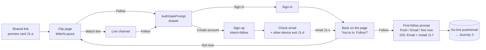
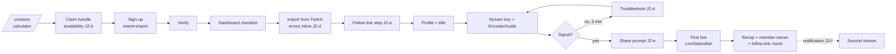
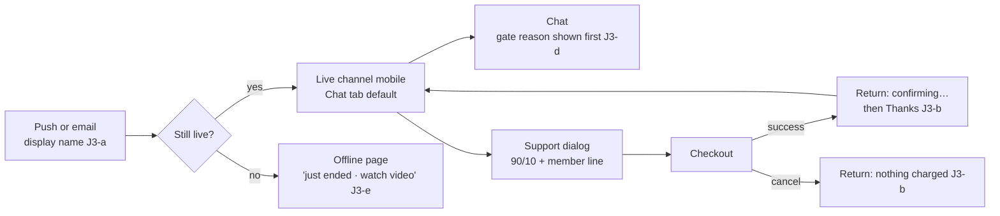
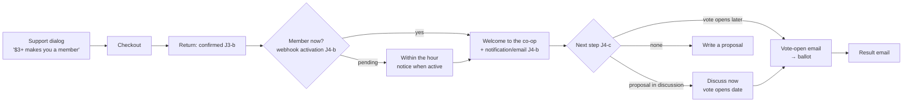
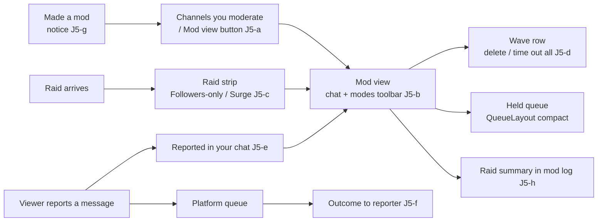
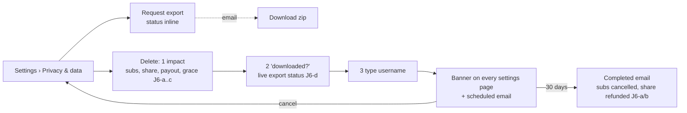

<!--
SPDX-FileCopyrightText: 2026 CommonAir contributors
SPDX-License-Identifier: CC-BY-SA-4.0
-->

# ux-journeys: six end-to-end persona journeys, and the gaps between the batches

Round 2, ux-journeys. Read-only: nothing in the repo or on staging was changed. Staging was walked
in a separate tab (`tab-17`, closed when done). As `streamer1` I only looked; I never clicked
follow, save, chat, vote or pay. Signed-out checks used `fetch(url, {credentials: "omit"})` and the
route source. Mockup links point to `round2/mockups/` (acquisition at `http://localhost:4174/`,
product at `http://localhost:4175/product/`). Some of those pages were still being built when I
wrote this. Every state I asked for has since been built, and is marked "built" (served on 127.0.0.1).

## 1. The question

Round 1 split the product across nine areas. This pass checks the **glue between them**: walk six
personas end to end today, write the same journey after the plan, and find what the plan does not
cover. That means missing screens, dead ends, handoffs between batches, the emails and
notifications in between, and the error and empty states on the way.

**Recommendation (headline).** The plan fixes the first screen of almost every journey, and
leaves the **moments between screens** unowned. Add a small **D0.5 "journey glue"** slice of nine
items, folded into existing batches, before D2 to D7 run side by side (section 9):

1. **Link previews.** No page on staging serves `og:` or `description` meta, so every shared clip,
   channel and proposal unfurls as a bare URL. Owner: D3.
2. **A checkout return state.** Stripe's `successUrl` and `cancelUrl` are the same URL
   (`services/api/src/money/checkout.ts:103-106`), so after paying, nothing says it worked. This
   blocks D2.6's "Welcome to the co-op". Owner: D2.
3. **Honest membership timing and a first vote that can really be cast.** Membership through a
   subscription starts at the next hourly sync. Electorates are frozen when voting opens, so a new
   member can't vote on the proposal the plan sends them to. Owners: D2 and D6.
4. **The sign-up default destination.** The verification link defaults to `/dashboard`
   (`apps/web/src/lib/auth.ts:50`). F11 fixes sign-in only. Owner: Fix first.
5. **Channel moderation, which the plan hardly covers.** Chat modes exist only as undocumented
   slash commands. A non-owner moderator has no link to the mod view. There's no incoming-raid
   alert, and the per-message menu has no "Delete message". Owners: D4 and D5.
6. **Reporter and moderator notices.** Reporters never hear an outcome, and nobody is told they
   were made a moderator. Owner: D7.
7. **Deletion side effects.** I found no code that cancels a paid subscription or exits the co-op
   when an account is deleted. To verify. Owners: D7 and the orchestrator.
8. **Push on iOS.** It needs the site installed on the Home Screen first. The first-follow prompt
   must not offer a Push option that can't work. Owner: D4.
9. **Follow links in the creator flow.** They are the switcher's main tool, but they sit under
   "Move channel", which reads as leaving. Owner: D5.

---

## 2. Method and legend

- **Friction:** 0 = none, 1 = mild (reads twice), 2 = real (needs a detour or a guess),
  3 = blocking (most people stop here).
- **Emotion:** one word for what the person likely feels at that step.
- **Plan refs:** the README's IDs (F1–F11, D1.x–D7.x). **J-gaps** are new; each has a fix and a
  batch.
- **Evidence** is a staging observation (2026-11-06) or a file:line.

## 3. Journey 1: a first-time visitor from a shared clip link → follows → alerts on

Persona: "Sam" taps a clip of Lumen Beats that a friend posted in a group chat, on a phone, with no
account.

### Today

| #   | Screen                              | User goal            | What they see (evidence)                                                                                                                                                                                                                                       | Friction | Emotion     |
| --- | ----------------------------------- | -------------------- | -------------------------------------------------------------------------------------------------------------------------------------------------------------------------------------------------------------------------------------------------------------- | -------- | ----------- |
| 0   | Link preview in the chat app        | Decide to tap        | A bare URL. There is no `og:title`, `og:image` or `description` on the clip, channel, home or proposal pages; the SSR head has only charset, color-scheme and theme-color.                                                                                     | 3        | indifferent |
| 1   | `/demo_streamer2/clips/01a1…` (375) | Watch the moment     | The cookie and storage notice, then a grey skeleton ("Loading the video" is all the SSR renders), then the clip, "0 views" and "Clipped by Lumen Beats". The channel card shows LIVE · 9 with **Watch live** and **Follow**.                                   | 1        | curious     |
| 2   | Tap Follow                          | Follow               | A bare `/signin` with no redirect (`channel-follow.tsx:62`, GF-1).                                                                                                                                                                                             | 3        | annoyed     |
| 3   | `/signin` → "New here? Sign up"     | Make an account      | The sign-up page, with the target lost.                                                                                                                                                                                                                        | 2        | lost        |
| 4   | `/signup`                           | Finish quickly       | Six controls (email, username "also your channel address", password, a three-select birth date, terms, ALTCHA). Nothing says the account is free. "Already a member?".                                                                                         | 2        | wary        |
| 5   | Check-email screen, then the email  | Verify               | "Check your email" with Resend and no next step. The email says "finish setting up your account" and never names the channel.                                                                                                                                  | 2        | waiting     |
| 6   | Tap the verify link                 | Get back to the clip | Auto sign-in, then a landing at **`/dashboard`**, the creator studio. With no `redirect` the target is `undefined` (`auth-return.ts:55`), and `signUp()` defaults to `/dashboard` (`lib/auth.ts:50`). A mail app's in-app browser signs in only that web view. | 3        | confused    |
| 7   | Find Lumen Beats again → Follow     | Follow               | Works if they remember the name.                                                                                                                                                                                                                               | 2        | effortful   |
| 8   | Alerts                              | Hear when live       | Nothing asks. Go-live email is off by default (`contracts/notify.ts`), and the push toggle is buried in `/settings/notifications`.                                                                                                                             | 3        | (unaware)   |

**Drop-off points:** 0 (no preview, no tap), 2→3 (the wrong form), 6 (wrong place) and 8 (a silent
follow that never brings them back). By the end, most visitors who got this far have followed and
will never come back.

### After the plan

| #   | Screen (mockup)                                                                                                                                                                                                             | What they see                                                                                                             | Plan items         | Friction | Emotion    |
| --- | --------------------------------------------------------------------------------------------------------------------------------------------------------------------------------------------------------------------------- | ------------------------------------------------------------------------------------------------------------------------- | ------------------ | -------- | ---------- |
| 0   | Link preview ([mock, built](http://127.0.0.1:4174/channel-gate.html?entry=clip&gate=follow))                                                                                                                                | **Still a bare URL**: no item covers it                                                                                   | **J1-a (gap)**     | 3 → 0    | curious    |
| 1   | Clip page (WatchLayout)                                                                                                                                                                                                     | Sticky player; "Watch from this moment" in the full video; next clip; "New clip" instead of "0 views"                     | D3.9, D4.1, WX-18  | 0        | engaged    |
| 2   | Follow → AuthGatePrompt drawer, [`channel-gate.html?gate=follow`](http://localhost:4174/channel-gate.html?gate=follow) ([`?entry=clip&gate=follow`](http://127.0.0.1:4174/channel-gate.html?entry=clip&gate=follow), built) | "Follow Lumen Beats. Get told when they go live. Free account." [Create account] Sign in                                  | D2.1, D4 placement | 0        | reassured  |
| 3   | [`signup.html?intent=follow&channel=lumen-beats`](http://localhost:4174/signup.html?intent=follow&channel=lumen-beats)                                                                                                      | "Create a free account to follow Lumen Beats", three ticks, birth date on one row from `sm`                               | D2.2               | 1        | ok         |
| 4   | [`…&step=sent`](http://localhost:4174/signup.html?intent=follow&channel=lumen-beats&step=sent)                                                                                                                              | "Open the link we sent to {email}", "Wrong address? Start over", the digest opt-in unticked, live channels while you wait | D2.2, D7.3         | 1        | waiting    |
| 5   | Verify email                                                                                                                                                                                                                | **Still generic**: it doesn't name Lumen Beats                                                                            | **J1-c (gap)**     | 1        | -          |
| 6   | Back on the clip → [`…&step=confirm`](http://localhost:4174/signup.html?intent=follow&channel=lumen-beats&step=confirm)                                                                                                     | "You're in. Follow Lumen Beats?" [Follow] [Not now]                                                                       | D2.1               | 0        | pleased    |
| 7   | First-follow prompt ([`channel-live-mobile.html`](http://localhost:4175/product/channel-live-mobile.html))                                                                                                                  | "Get told when Lumen Beats goes live?" Push · Email · Not now                                                             | D4.3, D7.3         | 0–2      | in control |
| 8   | Following menu                                                                                                                                                                                                              | Alert level, "Email me if they move", Unfollow                                                                            | D4.3               | 0        | settled    |

**Remaining drop-offs:** the preview (0), cross-device verification (6) and push on iPhone (7).

### Gaps in journey 1

| ID   | Gap                                                                                                                                               | Fix                                                                                                                                                                                                                                                                                                                                                                                                              | Batch                                 |
| ---- | ------------------------------------------------------------------------------------------------------------------------------------------------- | ---------------------------------------------------------------------------------------------------------------------------------------------------------------------------------------------------------------------------------------------------------------------------------------------------------------------------------------------------------------------------------------------------------------- | ------------------------------------- |
| J1-a | **No link previews anywhere.** Clips are the plan's biggest content gain (D3.7), and each share unfurls blank.                                    | Add `og:title`, `og:description`, `og:image` (the clip or VOD thumbnail, the live thumbnail or banner for a channel, a token-built SVG→PNG card for proposals and `/transparency`), `og:type=video.other` and `twitter:card=summary_large_image` (meta only, no script) from each route's `head()`. 18+ and restricted content gets a neutral card with no thumbnail. A self-hosted oEmbed endpoint is optional. | **D3** (with D3.9 sharing). SSR head. |
| J1-b | **The clip page renders only a skeleton in SSR,** so the first paint is grey even on a fast link.                                                 | SSR the title, channel card and thumbnail poster; WX-16 already proposes the poster for live.                                                                                                                                                                                                                                                                                                                    | D3/D4                                 |
| J1-c | **The verification email ignores intent.**                                                                                                        | Pass the intent and channel display name to `verifyEmail` ("Confirm your email to follow Lumen Beats"). Don't name the channel for `intent=watch` (18+), for privacy. Needs a template variable, with no PII beyond the user's own.                                                                                                                                                                              | D2                                    |
| J1-d | **Cross-device and in-app-browser verification.** The link signs in the browser that opens it, so the original tab still says "Check your email". | On the check-email screen: "Opened the link on another device? [Sign in here]" (keeps `redirect` and `intent`). In the same browser, a `BroadcastChannel` message from the verified tab can move the waiting tab on (first-party, no polling).                                                                                                                                                                   | D2                                    |
| J1-e | **Sign-up's default destination is `/dashboard`.** F11 covers sign-in only.                                                                       | `signUp()` and `resendVerificationEmail()` default to `/` for intents none, follow, chat, support, clip, watch and join, and to `/dashboard` only for stream and import.                                                                                                                                                                                                                                         | **Fix first (extend F11)**            |
| J1-f | **Push on iOS needs the site on the Home Screen** (Safari 16.4+). Offering Push in Safari on an iPhone gives a dead option or a silent failure.   | The first-follow prompt checks for `PushManager` and standalone mode. On iOS outside standalone it shows [Email me] and "Add CommonAir to your Home Screen for alerts". The install sheet is responsive-a11y's.                                                                                                                                                                                                  | D4.3, with D7.6                       |
| J1-g | **The channel may be offline by the time they confirm.**                                                                                          | The confirm still works. After it, the page is the offline content page (D3.8), with the next stream when known.                                                                                                                                                                                                                                                                                                 | D3.8 (check only)                     |

---

## 4. Journey 2: a Twitch streamer weighing a switch

Persona: "Rae", a Twitch affiliate with 300 followers, who heard about the 90% split.

### Today

| #   | Screen                                       | User goal              | What they see (evidence)                                                                                                                                                           | Friction | Emotion     |
| --- | -------------------------------------------- | ---------------------- | ---------------------------------------------------------------------------------------------------------------------------------------------------------------------------------- | -------- | ----------- |
| 1   | `/creators`                                  | Read the pitch         | **404** (fetch, signed out): "This channel does not exist".                                                                                                                        | 3        | doubtful    |
| 2   | Home, footer                                 | Find "for creators"    | No creator CTA; the footer has Transparency, attestations, NCII, DMCA and Source.                                                                                                  | 2        | lost        |
| 3   | `/transparency`                              | Check the money        | The 90/10 split six screens down; "Creators 27%" (F4); a −$11k surplus with no context.                                                                                            | 2        | suspicious  |
| 4   | `/signup` (generic)                          | Claim a name           | No handle check and no streaming framing.                                                                                                                                          | 1        | neutral     |
| 5   | Verify → `/dashboard`                        | Get set up             | An empty control room with "You are offline", empty forms and chat (CS-1).                                                                                                         | 3        | overwhelmed |
| 6   | `/dashboard/settings`                        | Stream key and OBS     | The RTMP URL and key; one sentence of OBS help. The API's `recommended` settings, `whipUrl` and `obsConfig` aren't shown (CS-2).                                                   | 3        | stuck       |
| 7   | `/import` (Tools; the flag is on in staging) | Bring the channel over | Connect Twitch, then a preview of details and emotes. Panels are pasted by hand. The page ends with a result list and **no next step**.                                            | 1        | ok          |
| 8   | `/move`                                      | Bring the audience     | Titled "Move your channel"; follow links share one page with "Moved to" (leaving) and the bundle export. A switcher has to work out that a "follow link" is their recruiting tool. | 2        | unsure      |
| 9   | First live                                   | Go live                | Nothing marks the moment. Followers here are few, and go-live email is off by default.                                                                                             | 2        | lonely      |
| 10  | After the stream                             | Learn how it went      | No recap. Analytics shows a peak of 4 while the dashboard showed 16 (F6). No "VOD ready" message.                                                                                  | 2        | flat        |

**Drop-off points:** 1 (no pitch), 5 and 6 (no first run; most never reach a first stream) and 10
(no reason to stream a second time).

### After the plan

| #   | Screen (mockup)                                                                                                                              | What they see                                                                                                                     | Plan items | Friction | Emotion    |
| --- | -------------------------------------------------------------------------------------------------------------------------------------------- | --------------------------------------------------------------------------------------------------------------------------------- | ---------- | -------- | ---------- |
| 1   | [`creators.html`](http://localhost:4174/creators.html) with the calculator ([`#calculator`](http://localhost:4174/creators.html#calculator)) | "Keep 90% from your first sub". Dated competitor rows (Kick's 95% shown honestly); the $25 minimum and 7-day hold in the footnote | D2.4, F10  | 0        | interested |
| 2   | [`#claim`](http://localhost:4174/creators.html#claim) → [`signup.html?intent=import`](http://localhost:4174/signup.html?intent=import)       | The claimed handle prefilled; "Start streaming on CommonAir"                                                                      | D2.2, D2.4 | 1        | committed  |
| 3   | Verify → [`studio-dashboard.html?state=new`](http://localhost:4175/product/studio-dashboard.html?state=new)                                  | "Ready to go live: 0 of 7 done", with `import_twitch` first                                                                       | D5.1       | 0        | guided     |
| 4   | Import (inline step or `/import`)                                                                                                            | Details and emotes; panels pasted                                                                                                 | D5.1       | 1        | ok         |
| 5   | Key, then encoder                                                                                                                            | CopyField + Reveal, EncoderGuide, OBS profile; "Waiting for your encoder…" → "Signal received"                                    | D5.1       | 1        | capable    |
| 6   | First live, LiveStatusBar ([`?state=live`](http://localhost:4175/product/studio-dashboard.html?state=live))                                  | "You're live. Support is on from this stream."                                                                                    | D5.2       | 0        | excited    |
| 7   | Recap ([`?state=recap`](http://127.0.0.1:4175/product/studio-dashboard.html?state=recap), built)                                             | Numbers, the "You're a member-owner" notice, "After your first stream" steps                                                      | D5.3, D6   | 0        | proud      |

### Gaps in journey 2

| ID   | Gap                                                                                                                                                                                                                | Fix                                                                                                                                                                                                                                                                                                                                                                           | Batch                             |
| ---- | ------------------------------------------------------------------------------------------------------------------------------------------------------------------------------------------------------------------ | ----------------------------------------------------------------------------------------------------------------------------------------------------------------------------------------------------------------------------------------------------------------------------------------------------------------------------------------------------------------------------- | --------------------------------- |
| J2-a | **The audience step is missing.** The checklist imports the channel but never helps bring the viewers. Follow links (counted conversions, ADR 0031/0037) sit on `/move` beside "Moved to", which reads as leaving. | Add a checklist step `follow_link` ("Bring your viewers: pin this link in your Twitch panels and chat", CopyField and the counted follows), shown when `intent=import` or a Twitch identity is linked. Repeat it in the recap ("{n} people followed through your link"). Rename the studio item "Follow links & moving". Measurement uses the existing move-link conversions. | **D5** (D5.1, D5.8)               |
| J2-b | **"Claim your handle" has no API to check availability.**                                                                                                                                                          | A contract request: a rate-limited `GET /auth/username-available?u=` that answers available / taken / reserved (the F10 list). The answer never says whether an account exists beyond what the public channel URL already shows.                                                                                                                                              | D2 (contract)                     |
| J2-c | **`/creators` must follow the instance flags.** Import is optional (`twitchImport`) and payouts may be unset ("The instance has not set up payouts yet").                                                          | Hide "Bring your Twitch channel" when the flag is off. Never show the calculator's "you keep" promise as payable when payouts aren't configured: say "Payouts open on this instance soon".                                                                                                                                                                                    | D2.4                              |
| J2-d | **Failure branches in the checklist:** import `denied`, `mismatch` (the Twitch account differs from the linked sign-in), `failed`, an expired preview; and the encoder never connecting.                           | Each import outcome renders inside the step with one next action (the existing `twitchImport.outcome.*` copy is good). For the encoder: after 3 minutes with no signal, show "Still waiting? Check these 3 things" (the server URL, the key, the firewall or port), a rehearsal link, and help.                                                                               | D5.1                              |
| J2-e | **The empty-room first stream.** Nothing helps them announce it.                                                                                                                                                   | On the first `encoder_connected`, offer ShareMenu ("Copy your channel link", "Copy the follow link") beside the LiveStatusBar. One message, no hype.                                                                                                                                                                                                                          | D5.2, with D3.9 ShareMenu         |
| J2-f | **Nothing lands between the first and second stream.** The plan lists "your video is ready" as a contract request but no email.                                                                                    | Send the recap as an in-app notification, with an email only if the streamer opted in (a new `creator` preference type). Ties to `second_live_within_14d`.                                                                                                                                                                                                                    | D5.3 + D7.3 (contract: `creator`) |
| J2-g | **The recap numbers depend on F6.**                                                                                                                                                                                | Block D5.3 on the viewer-count decision (round-2 viewer-count).                                                                                                                                                                                                                                                                                                               | D5 ← F6                           |
| J2-h | **Payout setup isn't in the first-run path,** and the streamer learns the $25 minimum only from the FAQ.                                                                                                           | The post-first-stream checklist gains "Get paid: add payout details" when the instance supports payouts, with the minimum and the schedule in one line.                                                                                                                                                                                                                       | D5.1 / D5.7                       |

---

## 5. Journey 3: a returning follower on mobile, from notification to support

Persona: "Ola" follows Lumen Beats and gets a go-live alert on an Android phone.

### Today

| #   | Screen                  | User goal      | What they see (evidence)                                                                                                                                                        | Friction | Emotion    |
| --- | ----------------------- | -------------- | ------------------------------------------------------------------------------------------------------------------------------------------------------------------------------- | -------- | ---------- |
| 0   | (Getting alerts at all) | -              | Only if they found the push toggle. Email is off by default.                                                                                                                    | 3        | -          |
| 1   | Push notification       | Recognise it   | **"demo_streamer2 is live"**: the service worker builds the title from the slug (`sw.ts`, `pwa.push.live {channel}` with `slug`), with no avatar.                               | 1        | unsure     |
| 2   | Tap → `/demo_streamer2` | Watch          | It plays. If `/me` is rate-limited the member is bounced to `/signin` (F1).                                                                                                     | 1–3      | -          |
| 3   | Scroll for chat         | Chat           | Chat about 1000 px down; the player scrolls away (WX-1).                                                                                                                        | 3        | frustrated |
| 4   | Type in chat            | Say hi         | Possibly "This chat is for viewers who have been watching for a little while" (the verified-watch gate) or "Your account is too new" (`minAccountAgeDays`), shown after typing. | 2        | rebuffed   |
| 5   | Support → dialog        | Subscribe $3   | Tiers, the 90/10 bar, the card fee covered by the co-op. Strong, but no co-op line (CT-11).                                                                                     | 1        | fine       |
| 6   | Stripe checkout         | Pay            | Leaves the page; the stream stops.                                                                                                                                              | 1        | -          |
| 7   | Return                  | Know it worked | **The same URL whether paid or cancelled** (`checkout.ts:103-106`); no toast, no badge until the webhook lands. A receipt email arrives later.                                  | 3        | anxious    |

**Drop-off points:** 0 (never alerted), 3 (no chat) and 7 (thinks it failed, retries or disputes).

### After the plan

| #   | Screen (mockup)                                                                                                                                                                                                                                     | What they see                                                         | Plan items     | Friction | Emotion  |
| --- | --------------------------------------------------------------------------------------------------------------------------------------------------------------------------------------------------------------------------------------------------- | --------------------------------------------------------------------- | -------------- | -------- | -------- |
| 0   | First-follow prompt                                                                                                                                                                                                                                 | Opted in at follow time                                               | D4.3           | 0        | -        |
| 1   | Push                                                                                                                                                                                                                                                | **Still the slug**: D7.3 fixes inbox rows, not the push payload       | **J3-a (gap)** | 1        | -        |
| 2   | [`channel-live-mobile.html`](http://localhost:4175/product/channel-live-mobile.html)                                                                                                                                                                | Sticky 16:9 player, compact row, Chat tab by default, composer pinned | D4.1, F1       | 0        | at home  |
| 3   | Chat                                                                                                                                                                                                                                                | `role=log`, "N new messages" pill, slim pinned strip                  | D4.1, D4.4     | 0        | involved |
| 4   | Support (overflow at 320, About tab)                                                                                                                                                                                                                | Breakdown + "A $3+ monthly sub also makes you a co-op member"         | D2.6, D4.1     | 1        | generous |
| 5   | Return from checkout ([`?state=checkout-pending`](http://127.0.0.1:4175/product/channel-live-mobile.html?state=checkout-pending) → [`?state=checkout-return`](http://127.0.0.1:4175/product/channel-live-mobile.html?state=checkout-return), built) | **Not in the plan**                                                   | **J3-b (gap)** | 3 → 0    | relieved |

### Gaps in journey 3

| ID   | Gap                                                                                                                                              | Fix                                                                                                                                                                                                                                                                                                                                                                                                                        | Batch                                          |
| ---- | ------------------------------------------------------------------------------------------------------------------------------------------------ | -------------------------------------------------------------------------------------------------------------------------------------------------------------------------------------------------------------------------------------------------------------------------------------------------------------------------------------------------------------------------------------------------------------------------- | ---------------------------------------------- |
| J3-a | **The push payload is slug-only** (`{v:1,type:"go_live",slug,title}`), and push carries no `?src`, so `follow.from_notification` can't count it. | Payload v2 adds `displayName` (≤50) and an avatar from our own storage, used as `icon`. The click URL gains `?src=push` (add `push` to the `src` enum; strip it after counting). This is the same contract request as D7.3's inbox fix, extended to push.                                                                                                                                                                  | D7.3 (contract)                                |
| J3-b | **There's no checkout return state.** It blocks D2.6's "Welcome to the co-op" and every "Thanks" moment.                                         | Distinct return URLs: `?checkout=success&cs={CHECKOUT_SESSION_ID}` and `?checkout=cancelled`. On success, show "Payment received, confirming…" and poll the payment status (a read-only endpoint by session id, scoped to the caller), then "Thanks. Lumen Beats gets $2.70" plus a membership line (J4-b). On cancel: "Checkout cancelled. Nothing was charged." The manual (bank) adapter keeps its instructions dialog. | **D2.6** (contract: return URLs + status read) |
| J3-c | **Paying stops the stream.**                                                                                                                     | After return, the player resumes at the live edge (not a stale DVR position), and the toast doesn't cover the player (D4.1 rule).                                                                                                                                                                                                                                                                                          | D4                                             |
| J3-d | **Chat gates show only after you type.**                                                                                                         | When `canChat` is false at join, the composer row shows the reason in place ("Chat opens after a few minutes of watching", "Verify your email to chat") before any typing. The resume after a `chat` intent says this too. Never say how close they are (ADR 0015).                                                                                                                                                        | D4.4, with D2.1                                |
| J3-e | **The notification can be stale:** the stream ended before the tap.                                                                              | It lands on the offline content page (D3.8) with "Lumen Beats just ended · Watch the video". The service worker closes tagged `go-live-{slug}` notifications on a `stream.offline` push (optional).                                                                                                                                                                                                                        | D3.8 (+ optional SW)                           |

---

## 6. Journey 4: a viewer becomes a co-op member through a $3 sub, then votes

Persona: "Ola" again, who subscribes at $3 and wants a say.

### Today

| #   | Screen               | User goal             | What they see (evidence)                                                                                                                                                                                                                                                                        | Friction | Emotion    |
| --- | -------------------- | --------------------- | ----------------------------------------------------------------------------------------------------------------------------------------------------------------------------------------------------------------------------------------------------------------------------------------------- | -------- | ---------- |
| 1   | Support dialog       | Subscribe             | Nothing says a $3+ sub makes you a member (CT-11). Staging rules: `minSubscriptionCents: 300`, `activeSubscriptionQualifies: true`.                                                                                                                                                             | 2        | unaware    |
| 2   | Return from checkout | Confirmation          | None (J3-b).                                                                                                                                                                                                                                                                                    | 3        | anxious    |
| 3   | (Membership starts)  | Know they're a member | It happens at the next **hourly** `membership-sync` (`coop-membership-sync.ts`, cron `5 * * * *`). **No notification or email** (no notification type; the governance package sends none).                                                                                                      | 3        | unaware    |
| 4   | `/coop/membership`   | See status            | Signed in: a rules sentence and "53.92 of 0.01 hours" (GF-14). Under a 429 it redirects to `/signin` (F1).                                                                                                                                                                                      | 2        | puzzled    |
| 5   | `/coop/proposals`    | Find a vote           | Rows without deadline or author (CT-6); 58 duplicate "vote open" items in the inbox (F8).                                                                                                                                                                                                       | 2        | overloaded |
| 6   | Proposal → vote      | Vote                  | The live vote ("Publish the co-op budget every quarter", 30/226 voted, closes Nov 13) opened **before they joined**, so they get "You were not a member when voting opened, so you are not in this vote's electorate." (`coop.vote.notInElectorate`; the electorate is frozen, `policy.ts:75`). | 3        | let down   |
| 7   | Later vote           | Vote                  | A `governanceVoteOpened` email ("Vote now: {proposal}"); JSON "What changes" (CT-4).                                                                                                                                                                                                            | 2        | -          |

### After the plan

| #   | Screen (mockup)                                                                                                                                         | What they see                                                                                                                            | Plan items            | Friction | Emotion   |
| --- | ------------------------------------------------------------------------------------------------------------------------------------------------------- | ---------------------------------------------------------------------------------------------------------------------------------------- | --------------------- | -------- | --------- |
| 1   | Support dialog                                                                                                                                          | "A $3+ monthly sub also makes you a co-op member"                                                                                        | D2.6                  | 0        | motivated |
| 2   | Checkout return                                                                                                                                         | "Welcome to the co-op" → `/coop/proposals`. **Inaccurate twice**: no return state exists (J3-b), and membership isn't active yet (J4-b). | D2.6 + **J3-b, J4-b** | 2        | -         |
| 3   | [`membership.html`](http://localhost:4174/membership.html) ([`?state=joined-by-sub`](http://127.0.0.1:4174/membership.html?state=joined-by-sub), built) | The pitch for non-members; the panel for members                                                                                         | D2.5                  | 1        | -         |
| 4   | Proposals list / detail                                                                                                                                 | ProposalCard v2, deadline, quorum tick, "90% → 85%", vote bars                                                                           | D6.2                  | 0        | capable   |
| 5   | Vote                                                                                                                                                    | **Still "not in electorate"** on any vote opened before they joined                                                                      | **J4-c (gap)**        | 3        | let down  |

### Gaps in journey 4

| ID   | Gap                                                                                                                                                                      | Fix                                                                                                                                                                                                                                                                                                                                                                                                                                                                                                                                                                                                     | Batch                                          |
| ---- | ------------------------------------------------------------------------------------------------------------------------------------------------------------------------ | ------------------------------------------------------------------------------------------------------------------------------------------------------------------------------------------------------------------------------------------------------------------------------------------------------------------------------------------------------------------------------------------------------------------------------------------------------------------------------------------------------------------------------------------------------------------------------------------------------- | ---------------------------------------------- |
| J4-a | **No checkout return state.**                                                                                                                                            | See J3-b.                                                                                                                                                                                                                                                                                                                                                                                                                                                                                                                                                                                               | D2.6                                           |
| J4-b | **Membership starts within the hour, silently.**                                                                                                                         | Option A (recommended, orchestrator): when the subscription payment confirms, run the same qualification in the webhook transaction and activate there (with the audit row and `coop.membership.update` event). The hourly sync stays as the backstop. Option B: copy only, "You'll be a co-op member within the hour". Either way, add a **`membership` notification** (in-app and email, "You're a member of the CommonAir co-op", with what you can do now) and a membership line on the `paymentReceipt` email. coop-trust's funnel step 6 assumed this notice; it never reached the contract list. | D2.6 + D6 + D7.3 (contract: notification type) |
| J4-c | **Frozen electorates make the plan's "point to the open vote" fail** for almost every new member. They can only vote on proposals whose voting starts after they joined. | The welcome state picks its next step from data: (1) a proposal in **discussion**, "Your first vote: {title}, voting opens {date}. Join the discussion now"; (2) else the next scheduled vote; (3) else "Write a proposal". On a proposal they can't vote on, say why in plain words and link to the next one. ProposalCard v2 gets a "You can vote" chip, computed server-side (`myEligibility` on the proposal DTO: contract).                                                                                                                                                                        | **D6.2** (+ contract), D2.6 copy               |
| J4-d | **Membership tied to a subscription lapses on cancel,** and the cancel flow doesn't say so.                                                                              | `/settings/subscriptions` cancel confirm: "This subscription is what makes you a co-op member. Cancelling ends your membership when it lapses; votes already open keep you in their electorate." (mirrors `coop.exit.noShare`). Offer "Keep membership with a $5 refundable share".                                                                                                                                                                                                                                                                                                                     | D7.1 (subscriptions page), D6                  |
| J4-e | **Gift subs don't qualify,** and a gift recipient may expect to be a member.                                                                                             | Support dialog: the member line appears only for own, non-gift subs ≥ the minimum. The gift tab says "Gifts don't make the recipient a member".                                                                                                                                                                                                                                                                                                                                                                                                                                                         | D2.6 copy                                      |
| J4-f | **The vote-open flood (F8) teaches people to ignore co-op notifications** just as they join.                                                                             | Ship F8 (dedupe, name the proposal, expire closed votes) before D2.6 turns on the cross-sell.                                                                                                                                                                                                                                                                                                                                                                                                                                                                                                           | Fix first, before D2.6                         |

---

## 7. Journey 5: a channel moderator handles a bad-chat raid and a report

Persona: "Kit", a volunteer moderator for Lumen Beats (not the owner). A raid lands with 40
accounts spamming slurs, and a viewer reports one of them.

The plan barely covers this journey. Its only moderation items are D7.5 (admin `QueueLayout`,
reused compactly in `/mod/$channel`), D4.4 (calm the chat column) and WX-25 (label the chat header
icons). Everything below comes from source; `streamer1` moderates only its own channel, so I did
not open another channel's mod view.

### Today

| #   | Screen                  | User goal                  | What they see (evidence)                                                                                                                                                                                                                                                                                       | Friction | Emotion     |
| --- | ----------------------- | -------------------------- | -------------------------------------------------------------------------------------------------------------------------------------------------------------------------------------------------------------------------------------------------------------------------------------------------------------- | -------- | ----------- |
| 0   | Becoming a mod          | Know they're a mod         | **No notice.** `NOTIFICATION_TYPES` has no role type, and no email template exists.                                                                                                                                                                                                                            | 2        | unaware     |
| 1   | Find the mod view       | Open the tools             | The studio nav links `/mod/<own channel>` only (`lib/nav.ts:299-304`). A non-owner mod must **type `/mod/demo_streamer2`**. There's no "Channels you moderate" list, and no link on the channel page (watch P11 adds owner shortcuts only).                                                                    | 3        | lost        |
| 2   | The raid lands          | Notice early               | The broadcaster's activity feed says "{name} raided with {n} viewers" (`studio.activity.raid`); the chat shows `chatRaid.incoming`. No mod-facing alert or suggested protections.                                                                                                                              | 2        | alarmed     |
| 3   | Lock chat down          | Slow or followers-only     | **No buttons.** Slow, followers-only, subs-only and emote-only, plus clear, exist only as slash commands (`contracts/chat.ts:51`); no web file sets `slowModeSeconds`; no command help. Surge mode can be started or ended from the banner, but only when the instance enabled the guard (`surge-banner.tsx`). | 3        | panicked    |
| 4   | Deal with the spam      | Remove messages and people | Calm chat groups repeated messages into a "wave" with **Report wave** (to platform staff). The per-message menu offers **Timeout (fixed 10 min)**, Ban (confirmed) and Block (`mod-menu.tsx`): **no Delete message**, no duration choice, no action on a whole wave.                                           | 3        | overwhelmed |
| 5   | The held queue          | Review filtered messages   | `/mod/$channel`: chat, a held-messages card, recent actions, each with its own Refresh.                                                                                                                                                                                                                        | 1        | ok          |
| 6   | A viewer reports a user | See and act on the report  | The report dialog says "Reports go to the platform's moderators". **Channel mods never see viewer reports** about their chat. The platform queue is a stacked list (AA-8).                                                                                                                                     | 2        | out of loop |
| 7   | The reporter            | Know what happened         | "Thanks. Your report was sent to the moderators." **No outcome later and no "your reports" page.** Email templates exist for the reported party (`enforcementStatement`) but none for the notifier.                                                                                                            | 2        | ignored     |
| 8   | Afterwards              | Review the raid            | The mod log lists actions; there's no summary ("raid by X: 38 timed out, 2 banned"), and nothing on the raider channel's standing.                                                                                                                                                                             | 1        | drained     |

### After the plan

| #   | Screen                                 | What changes                                         | Plan items                                                                 | Friction                              |
| --- | -------------------------------------- | ---------------------------------------------------- | -------------------------------------------------------------------------- | ------------------------------------- |
| 1   | Find the mod view                      | Nothing                                              | -                                                                          | 3                                     |
| 3   | Lock chat down                         | Nothing                                              | -                                                                          | 3                                     |
| 4   | Wave and message actions               | Calmer layout; labelled header icons                 | D4.4, WX-25                                                                | 2                                     |
| 5   | Mod view ([`mod-view.html?state=normal | raid                                                 | switcher`](http://127.0.0.1:4175/product/mod-view.html?state=raid), built) | QueueLayout compact for held messages | D7.5 | 1   |
| 6–7 | Reports                                | Platform staff get a faster queue; reporter: nothing | D7.5                                                                       | 2                                     |

### Gaps in journey 5 (all new)

| ID   | Gap                                                                                             | Fix                                                                                                                                                                                                                                                                                                                                                                                                                        | Batch                                 |
| ---- | ----------------------------------------------------------------------------------------------- | -------------------------------------------------------------------------------------------------------------------------------------------------------------------------------------------------------------------------------------------------------------------------------------------------------------------------------------------------------------------------------------------------------------------------- | ------------------------------------- |
| J5-a | **Moderators can't find their tools.**                                                          | (1) The studio nav gets a "Channels you moderate" group, or a channel switcher, from the member's channel roles (contract: a `me.moderates` list). (2) On a channel page where `canModerate`, a "Mod view" button among the owner and mod shortcuts (extend watch P11 to mods). (3) The account menu gets "Mod view" when the list isn't empty.                                                                            | D5.8 + D4.6 (contract)                |
| J5-b | **No chat-mode controls.**                                                                      | A **chat-modes toolbar** in the mod view and in the chat header for mods: Slow (off/5 s/30 s/2 min), Followers-only (with an age), Subs-only, Emote-only, Clear chat (`ConfirmDialog`), Surge on/off. Each is a `ToggleGroup` with a state chip that viewers also see ("Slow mode · 30 s"). It reuses the existing REST and command handlers, so no new server logic. Add a `/help` command list in the composer for mods. | **D4.4** (chat) + D5 (mod view)       |
| J5-c | **No raid-defence moment.**                                                                     | For mods and the owner, an incoming raid shows a pinned strip: "{channel} is raiding with {n} viewers" [Followers-only 10 min] [Surge mode] [Dismiss]. If a wave forms within 2 minutes of a raid, the strip escalates to "Lock down chat?" Nothing is automatic: mods choose.                                                                                                                                             | D4.4 / D5                             |
| J5-d | **Thin per-message and wave actions.**                                                          | The message menu for mods adds **Delete message** (the server already has `delete_message`), Timeout with durations (1 m, 10 m, 1 h, 24 h), and Report. The wave row adds "Time out all {n} senders" and "Delete all" (a contract request for a bulk mod action: one audit row per target, capped at the wave size, never bans).                                                                                           | D4.4 (+ contract for bulk)            |
| J5-e | **Reports bypass the channel's own team.**                                                      | Policy decision for the orchestrator. Recommended: a chat-message report also appears, without the reporter's identity, in that channel's mod view as "Reported in your chat", so mods can act on the chat side. Platform staff still decide the account-level outcome. Stream reports (the stream itself) stay staff-only.                                                                                                | D7.5 (QueueLayout compact) + contract |
| J5-f | **The reporter never hears back.** DSA Art. 16(5) expects the notifier to be told the decision. | A `report_outcome` notification (in-app always, email optional) and a "Your reports" list under Settings › Safety (status: received, under review, action taken, no action; no detail about the other person beyond what the policy allows).                                                                                                                                                                               | D7.1 + D7.3 (contract)                |
| J5-g | **No notice when you're made a moderator.**                                                     | A `role` notification ("Lumen Beats made you a moderator", with links to the Mod view and the chat rules) and a matching one when the role is removed.                                                                                                                                                                                                                                                                     | D7.3 (contract)                       |
| J5-h | **No raid summary.**                                                                            | The mod log groups actions within 10 minutes of a raid into one row ("Raid by X: 38 timeouts, 2 bans"), with "Report this raid" (to staff, with the message set).                                                                                                                                                                                                                                                          | D5 (mod view)                         |

---

## 8. Journey 6: a viewer exports their data and deletes their account

Persona: "Ola", who is leaving and wants a copy first. They hold a $3 sub and viewer membership.

### Today

| #   | Screen                               | User goal         | What they see (evidence)                                                                                                                                                                                                                                                                                                                            | Friction | Emotion   |
| --- | ------------------------------------ | ----------------- | --------------------------------------------------------------------------------------------------------------------------------------------------------------------------------------------------------------------------------------------------------------------------------------------------------------------------------------------------- | -------- | --------- |
| 1   | Account menu → Settings              | Find privacy      | Lands on Subscriptions (AA-3). At 375 a Select switches tabs.                                                                                                                                                                                                                                                                                       | 1        | searching |
| 2   | `/settings/privacy` (375, signed in) | Export            | "Your data and your account" first. Account data and channel data, each with [Request export]. "The link works for 7 days"; one a day; "We email you a link". The portability bundle is on `/move`, not here. Several "Loading" lines first.                                                                                                        | 1        | ok        |
| 3   | Email "Your data export is ready"    | Download          | A good email; "You will need to sign in to download it."                                                                                                                                                                                                                                                                                            | 1        | ok        |
| 4   | "Delete my account…"                 | Understand impact | "Your profile, sign-in methods, chat messages and media are removed. Payments, the ledger, votes and audit history stay, with your name and email removed." The **30-day grace** (`deletion.ts:16`) isn't stated before confirming (AA-12). Nothing about the subscription, membership share or pending payout.                                     | 2        | uncertain |
| 5   | Type username → Schedule             | Confirm           | Toast; the `accountDeletionScheduled` email with [Cancel deletion].                                                                                                                                                                                                                                                                                 | 1        | resolved  |
| 6   | The next 30 days                     | Know it's pending | No banner in settings (AA-12). The channel and profile stay public.                                                                                                                                                                                                                                                                                 | 2        | unsure    |
| 7   | Completion                           | Be gone           | The worker deletes credentials, follows and so on, and pseudonymizes users and channels. **I found no code that cancels the paid subscription or ends the co-op membership or share** (`services/worker/src/deletion/account-deletion.ts`; no `subscriptions` or `memberships` handling). To verify: the $3 sub may keep billing a deleted account. | 3 (risk) | -         |

### After the plan

| # | Screen ([`settings.html?state=privacy|delete|scheduled`](http://127.0.0.1:4175/product/settings.html?state=delete), built) | What they see | Plan items | Friction |
| --- | ---------------------------------------------------------------------------------------------------------------- | --------------------------------------------------------------------------------------------------------------------------------------------- | ------------------ | -------- |
| 1 | `/settings` → `/settings/account`, grouped nav | "Privacy & data" under Safety | D7.1 | 0 |
| 2 | Download your data | Three rows (account, channel, bundle) with status | D7.4 (P6) | 0 |
| 3 | Delete, step 1: impact | "{n} active subscriptions will be cancelled at period end", the payout, the share, the grace date | D7.4 + `me.deletion.preview` | 0 |
| 4 | Step 2: "I downloaded my data" with inline Download now | - | D7.4 | 0 |
| 5 | Step 3: type the username | - | D7.4 | 0 |
| 6 | Banner on every settings page | "Your account will be deleted on {date}. [Cancel deletion]" | D7.4 | 0 |

### Gaps in journey 6

| ID   | Gap                                                                                                    | Fix                                                                                                                                                                                                                                                                                                                                 | Batch                        |
| ---- | ------------------------------------------------------------------------------------------------------ | ----------------------------------------------------------------------------------------------------------------------------------------------------------------------------------------------------------------------------------------------------------------------------------------------------------------------------------- | ---------------------------- |
| J6-a | **The impact preview promises cancellations the server may not make.**                                 | Orchestrator to **verify, then decide**. On scheduling (or at completion), cancel provider subscriptions at period end, record the viewer-class exit (it starts the share refund per ADR 0020), and cancel any pending follow links and grants. Only then can D7.4 say "cancelled". Until then the preview must say the true thing. | **Orchestrator before D7.4** |
| J6-b | **The share refund needs a way to pay the person back,** yet the account is about to be pseudonymized. | The impact step says how the $5 share comes back (the treasurer contacts the address on file before completion), and the completion job waits on an open refund, or records it as owed by id. coop-trust and the treasury owner decide.                                                                                             | D6 + orchestrator            |
| J6-c | **The pending payout below the minimum for streamers** ($25 minimum, 7-day hold).                      | The impact list states "Earnings below $25 are paid … / held as …" per policy. That needs a policy line before the copy.                                                                                                                                                                                                            | D7.4 + coop-trust policy     |
| J6-d | **"Download first" can't finish in one sitting:** the export is async, emailed and one a day.          | Step 2 shows the live status of today's export (queued, preparing, ready) and lets the person schedule deletion anyway. The completion job keeps a ready export downloadable until its 7-day expiry or the grace end, whichever is sooner, and the `accountDeletionScheduled` email links to it.                                    | D7.4                         |
| J6-e | **Public visibility during the grace period** is unspecified.                                          | Recommend: the channel stays as is (deletion is cancellable), but going live during the grace period shows the owner "Deletion scheduled. Going live cancels nothing" in the LiveStatusBar. The profile gets no public marker.                                                                                                      | D7.4 + D5.2                  |
| J6-f | **Username release** is undefined. Account-admin flagged "only if the policy says so".                 | The orchestrator picks a policy (recommended: never re-issue a deleted username for 12 months, so a link can't be hijacked) and the preview states it.                                                                                                                                                                              | Orchestrator                 |

---

## 9. Cross-journey gaps: handoffs between batches, emails and errors

### 9.1 Handoffs the batch split creates

| Handoff                                              | Risk                                                                                                        | Fix                                                                                                                                                                      |
| ---------------------------------------------------- | ----------------------------------------------------------------------------------------------------------- | ------------------------------------------------------------------------------------------------------------------------------------------------------------------------ |
| D2.1 AuthGatePrompt (logic) → D3.8, D4.2 (placement) | D3 and D4 run beside D2, so placements ship against a component that doesn't exist yet, or with bare links. | Land `AuthGatePrompt`, `authHref(action)` and the `?intent` contract as the **first PR of D2**, before D3 and D4 open their placement PRs.                               |
| D2.6 "Welcome to the co-op" → D6.2 proposals         | It links into the JSON-era proposals page, and to votes the member can't cast (J4-c).                       | Ship D2.6's success state only after J3-b and J4-b; link to the J4-c "next step" logic, not to the raw list.                                                             |
| D4.3 first-follow prompt → D7.3 preferences          | The prompt writes `go_live`, which exists, but its "Email" path needs `consent_records` (D7.3).             | D4.3 depends on the consent write from D7.3; or move the consent write into D4.3.                                                                                        |
| D5.3 recap → D6 "member-owner" copy and F6           | Three owners for one card.                                                                                  | D5 owns the card; D6 supplies the copy keys; F6 decided first.                                                                                                           |
| D2.8 measurement → every batch                       | Surface ids are spread across four reports, with no single enum owner.                                      | One `UiMetric` enum PR in D2 that includes every id from all reports plus `src=push`, `checkout.return.*`, `mod.mode.*` and `firstVote.next`. Later batches only use it. |
| D7.5 QueueLayout → D5 mod view                       | The compact mode is specced only for the held queue.                                                        | Spec the compact QueueLayout for "Held" and "Reported in your chat" (J5-e).                                                                                              |

### 9.2 Emails and notifications in between (what's missing from the plan)

| Moment                                     | Exists?                                                   | Add                                                                                      | Batch          |
| ------------------------------------------ | --------------------------------------------------------- | ---------------------------------------------------------------------------------------- | -------------- |
| Verify email names the intent              | Generic                                                   | Intent and channel variables (J1-c)                                                      | D2             |
| Payment receipt                            | Yes (`paymentReceipt`, with "Where your money goes")      | A membership line when the payment qualifies                                             | D2.6           |
| "You're a co-op member"                    | **No**                                                    | `membership` notification and email (J4-b)                                               | D6 + D7.3      |
| Vote open / result                         | Yes (`governanceVoteOpened`, `governanceResultPublished`) | Only to the frozen electorate; F8 dedupe                                                 | Fix first (F8) |
| Go-live push                               | Slug only                                                 | Display name, avatar, `?src=push` (J3-a)                                                 | D7.3           |
| Stream recap or "your video is ready"      | **No**                                                    | `creator` type, in-app plus opt-in email (J2-f)                                          | D5.3 + D7.3    |
| Made or removed as a moderator             | **No**                                                    | `role` notification (J5-g)                                                               | D7.3           |
| Report outcome to the reporter             | **No**                                                    | `report_outcome` plus a "Your reports" page (J5-f)                                       | D7             |
| Export ready, deletion scheduled/completed | Yes                                                       | Link the ready export from the scheduled email (J6-d)                                    | D7.4           |
| Welcome after verify                       | No                                                        | **Don't add one.** The intent confirm on the page does the job; an extra email is noise. | -              |

### 9.3 Errors and empty states on the way

Every journey crosses F1 to F3 at least once: a 429 that signs people out, a 500 from SSR, a page
blanked by one failed section. Two more turned up on the way:

- **The post-verify landing under load.** If `/me` fails right after the verification redirect,
  F1 would send a brand-new member to `/signin` at their most fragile moment. F1's test should
  cover the `?intent` landing specifically.
- **"Loading" that never ends.** On `/settings/privacy`, "Loading" lines lingered for a few
  seconds with no skeleton shape (D1.4 covers the visuals). The deletion card showed "Loading" in
  place of its button, so the main action is missing until it loads.

## 10. Options and recommendation

| Option                                                                                                                                                       | Cost | Risk                                                                                                      | Impact                                                                                           |
| ------------------------------------------------------------------------------------------------------------------------------------------------------------ | ---- | --------------------------------------------------------------------------------------------------------- | ------------------------------------------------------------------------------------------------ |
| **A. Fold the J-gaps into their batches** as listed, plus three "glue first" rules (AuthGatePrompt first in D2; J3-b before D2.6; J6-a verified before D7.4) | M    | Batches grow a little                                                                                     | Every journey ends somewhere honest; closes the two silent-failure points (checkout, membership) |
| B. A separate "D8 journeys" batch at the end                                                                                                                 | M    | D2.6, D4.3 and D7.4 ship promising things the server doesn't do (welcome, cancellation), then get patched | Same, but later and with a window of misleading copy                                             |
| C. Only the bugs (J1-e, J3-b, J6-a), the rest later                                                                                                          | S    | Moderation stays slash-command-only; shares stay blank                                                    | Low; journeys 1 and 5 stay broken                                                                |

**Recommend A.** The gaps sit exactly where one batch hands over to another, so the batch that
creates the promise should carry the fix. Three items are real correctness or trust issues, not
polish:

1. **J3-b:** checkout gives no success signal.
2. **J4-c:** the plan would send new members to a vote they can't cast.
3. **J6-a:** a deleted account may keep being billed. This one is unverified.

**What would change my mind:**

- If the orchestrator confirms that deletion already cancels subscriptions elsewhere (for example,
  a provider webhook on customer deletion), J6-a drops to copy only.
- If the co-op decides new members **should** join open electorates, J4-c shrinks to copy, but
  that is a governance change and needs a protected vote.
- If staging traffic shows few shared links, J1-a can wait for D3's second half.

## 11. If accepted: changes to the plan

**Fix first:** add **J1-e** (the sign-up default destination) to F11. Ship **F8** before D2.6.

**D2:**

- AuthGatePrompt and the intent contract as the first PR.
- J1-c (intent in the verify email) and J1-d (the cross-device exit).
- J2-b (a contract: username availability) and J2-c (`/creators` follows the instance flags).
- **J3-b**, the checkout return state, which is a contract: return URLs plus a session status read.
- The J4-b copy, and J4-e (no member line for gifts).

**D3:**

- **J1-a**, OG and Twitter meta on clip, VOD, channel, proposal and transparency pages, with a
  neutral card for 18+ content.
- J1-b (SSR the clip poster) and J3-e (the "just ended" offline landing).

**D4:**

- J1-f (the iOS push path in the first-follow prompt).
- J3-c (resume at the live edge after checkout) and J3-d (chat gate reasons shown before typing).
- **J5-b**, the chat-modes toolbar.
- J5-c (the raid strip) and J5-d (Delete message, timeout durations, and wave actions, which need
  a contract).
- J5-a's channel-page "Mod view" button.

**D5:**

- **J2-a**, the follow-link checklist step plus its recap count, and the studio item rename.
- J2-d (failure branches), J2-e (the share prompt), J2-h (payout setup).
- J5-a (channels you moderate), J5-h (the raid summary), and the compact QueueLayout with
  "Reported in your chat".
- D5.3 waits on F6.

**D6:** **J4-c**, the "next step" welcome plus "You can vote" (a contract: `myEligibility`); J4-b
membership activation in the webhook (orchestrator); J6-b (the share refund on deletion, with the
treasury).

**D7:**

- New notification types `membership`, `creator`, `role` and `report_outcome`, plus J3-a's push
  payload v2 and `src=push`.
- J5-f ("Your reports").
- J4-d (subscription cancel copy).
- J6-c to J6-f.
- **J6-a verified first.**

**Contract and schema requests (new, for the orchestrator):**

- `GET /auth/username-available`.
- Checkout `successUrl` and `cancelUrl` with `?checkout=`, plus a caller-scoped checkout status
  read.
- Membership activation in the payment webhook.
- `Proposal.myEligibility`.
- `me.moderates`.
- A bulk wave moderation action.
- Notification types `membership`, `creator`, `role` and `report_outcome`.
- Push payload v2 (`displayName`, `avatarUrl`).
- `src` enum gains `push`.
- Report routing to the channel mod view (a policy decision).
- Deletion: cancel subscriptions and exit memberships (verify first).

**Mockups requested** (sent to the mockup agents). Acquisition has built all four: `channel-gate.html?entry=clip&gate=follow` (with the link-preview mock), `signup.html?…&step=sent` (with the other-device exit), `membership.html?state=joined-by-sub`, `import.html` and `creators.html#claim` (with availability states), plus `coop.html?state=busy` and `channel-gate.html?confirm=follow`, all at http://127.0.0.1:4174/. Product has built all five, at http://127.0.0.1:4175/product/: `channel-live-mobile.html?state=checkout-pending|checkout-return|firstfollow-ios`, `studio-dashboard.html?state=recap` (with the follow-link card, and the studio item renamed Grow › "Bring your audience"), `mod-view.html?state=normal|raid|switcher` and `settings.html?state=privacy|delete|scheduled`. What I originally asked for:

- **Product:**
  - channel-live-mobile `?state=checkout-return` and the iOS first-follow variant;
  - studio-dashboard `?state=recap` with the follow-link card;
  - a mod view with the chat-modes toolbar, the raid strip and a channel switcher;
  - settings `#privacy`, with the three-step deletion and the pending banner.
- **Acquisition:**
  - a clip-entry gate plus a link-preview card mock;
  - signup `step=sent` with the other-device exit;
  - membership `?state=joined-by-sub`, with the honest first vote;
  - `/import` signed out, and the claim-field availability states.

**Voice-copy:** I flagged the "Your first vote" conflict (J4-c) and the message gaps (a)–(g): the
checkout return, iOS push, the mod raid strip and modes, reporter feedback, the moderator notice,
deletion impact, and chat-gate reasons. **Resolved:** voice-copy wrote all of them in
`round2/voice-copy.md` §4.4 and §4.14.

- The sub success copy now reads "You'll be a member within the hour, and we'll tell you in your
  inbox".
- The welcome notice picks its first-vote line from the data, which matches J4-c.
- The deletion preview must not promise to cancel subscriptions until J6-a is fixed. It says
  "Deleting your account doesn't cancel subscriptions yet. Cancel them on your subscriptions page
  first."
- Report confirmations never name the reported person, and never say which action was taken.

## 12. References

- **Apple WebKit, "Web Push for Web Apps on iOS and iPadOS"** (webkit.org/blog/13878, 2023). Push
  only works for Home Screen web apps on iOS 16.4+. We borrow the feature detection and the "add
  to Home Screen" step (J1-f).
- **Stripe Checkout docs, "Customize redirect behavior"** (docs.stripe.com/payments/checkout/custom-success-page).
  `success_url` with `{CHECKOUT_SESSION_ID}`, and a separate `cancel_url`. We borrow the distinct
  URLs and the "confirming" state that waits on the webhook (J3-b).
- **The Open Graph protocol** (ogp.me), and X/Twitter Cards markup docs. These are meta tags only,
  so no third-party script (J1-a).
- **Twitch Help, "Shield Mode"** and the chat-modes moderator controls. They show one-tap
  lockdown presets and chat-mode toggles that viewers can see. We borrow the toolbar with state
  chips and the raid strip, not the AI-assisted parts (J5-b, J5-c).
- **EU Digital Services Act, Art. 16(5)–(6).** Hosting providers notify the notifier of their
  decision on a notice. We borrow the "your reports" status and the outcome notice (J5-f). This is
  not legal advice; the maintainer makes that call (no-counsel rule).
- **Internal:** README.md and the nine round-1 reports in `docs/design/2026-11-overhaul/`;
  `round2/voice-copy.md` (key messages); mockup URLs as relayed by mockups-acquisition and
  mockups-product.
